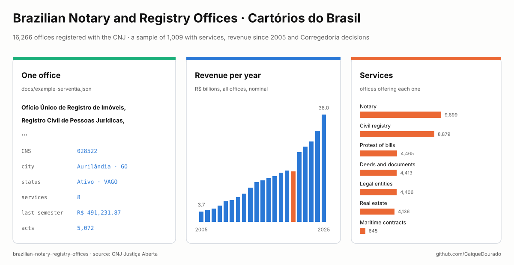
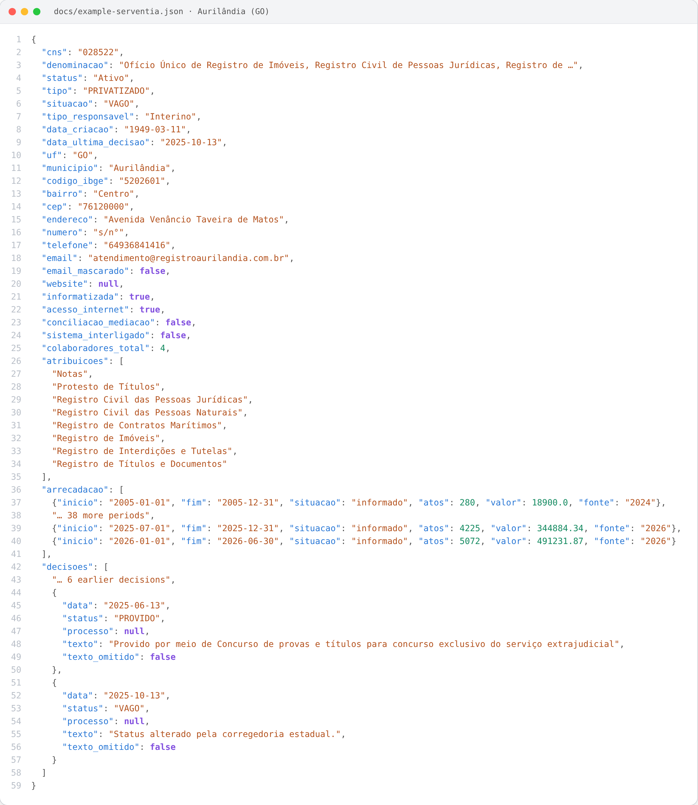
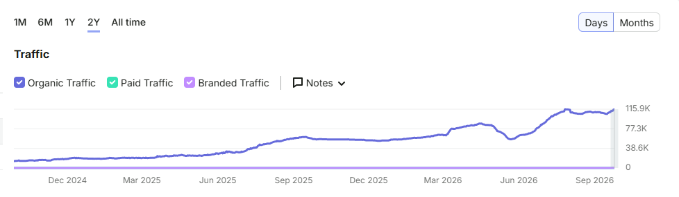
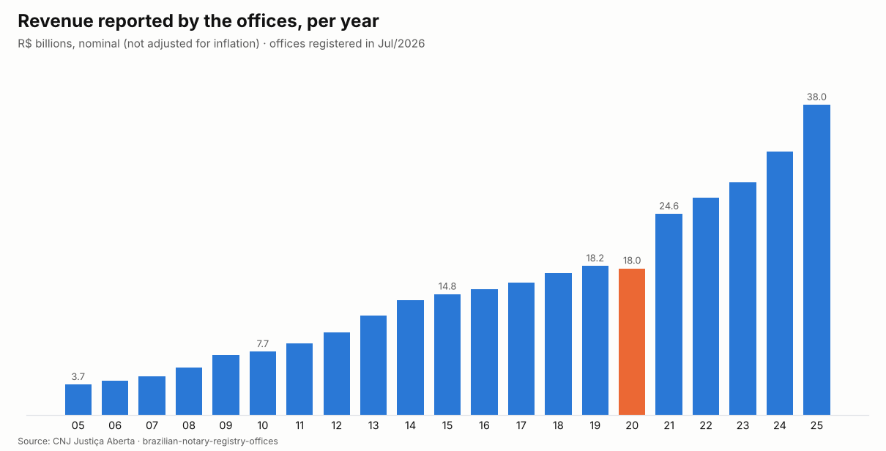
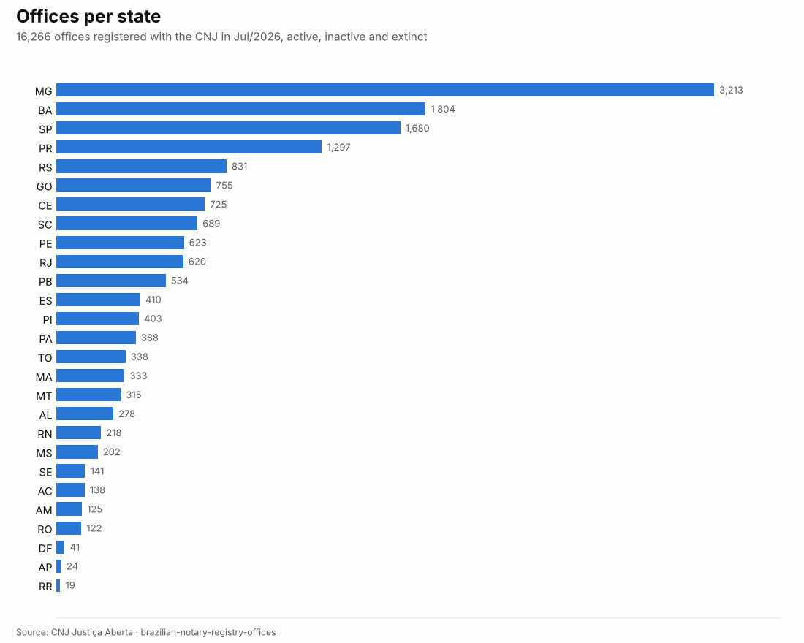
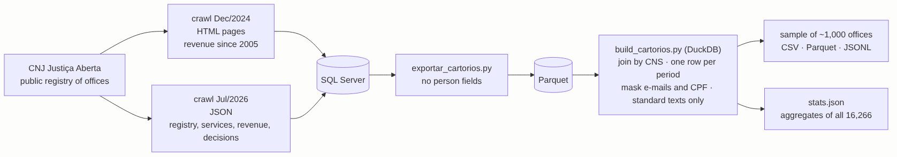

# Brazilian Notary and Registry Offices · Cartórios do Brasil

[](https://github.com/CaiqueDourado/brazilian-notary-registry-offices/actions/workflows/validate.yml)
[](LICENSE-DATA.md)
[](LICENSE)
[](https://www.kaggle.com/datasets/caiquedourado/brazilian-notary-registry-offices)

[Leia em português](README.pt-BR.md)



Brazil has **16,266 notary and registry offices** (*cartórios*, or *serventias extrajudiciais*) in the registry of
the National Council of Justice (CNJ): the places where deeds are signed, births and marriages are registered, property
is recorded and unpaid bills are protested. This dataset is a **sample of 1,009 of them**, stratified by state,
with everything the CNJ publishes about each one:

- the **registry**: name, CNS code, status, address, phone, institutional e-mail, opening hours, staff;
- the **services** each one provides (notary, civil registry, real estate…);
- the **acts and revenue** it reported, per semester, **from 2005 to 2026**;
- the **decisions of the CNJ Corregedoria** on it (filled by public exam, declared vacant…).

`stats.json` adds the aggregates of **all 16,266** offices (per state, status, service, revenue per year).

## What is inside

| File | Rows | What |
|---|---:|---|
| `serventias.csv` / `.parquet` | 1,009 | one office per row, registry of Jul/2026 |
| `atribuicoes.csv` | 2,311 | office × service |
| `arrecadacao.csv` | 38,272 | office × period: acts and revenue, 2005–2026 |
| `decisoes.csv` | 4,402 | office × Corregedoria decision |
| `serventias.jsonl` | 1,009 | the same sample, one nested JSON per office |
| `stats.json` | | counts of the build and aggregates of all 16,266 offices |

All files are in [`data/`](data) and on [Kaggle](https://www.kaggle.com/datasets/caiquedourado/brazilian-notary-registry-offices).
They join by `cns`, the national code of the office.

## One office in JSON



Each line of `serventias.jsonl` is one office with its services, revenue and decisions nested, like
[docs/example-serventia.json](docs/example-serventia.json) (the image cuts the long lists).

## Data dictionary

**serventias**

| Column | Example | What |
|---|---|---|
| `cns` | 028522 | Código Nacional de Serventia, 6 digits |
| `denominacao` | Ofício Único de Registro de Imóveis… | official name |
| `status` | Ativo | Ativo, Inativo or Extinto |
| `tipo` | PRIVATIZADO | PRIVATIZADO (run by a delegated notary), OFICIALIZADO (run by the state), PUBLICO |
| `situacao` | VAGO | legal situation: PROVIDO (filled by public exam), VAGO (vacant), INATIVA… |
| `tipo_responsavel` | Interino | Titular, Interino, Interventor… The person is **not** in the dataset |
| `data_criacao` | 1949-03-11 | creation date |
| `data_ultima_decisao` | 2025-10-13 | date of the latest CNJ decision |
| `uf`, `municipio` | GO, Aurilândia | state and municipality |
| `codigo_ibge` | 5202601 | IBGE code: joins [municipios-e-estados-do-brasil](https://github.com/CaiqueDourado/municipios-e-estados-do-brasil) |
| `bairro`, `cep`, `endereco`, `numero` | Centro, 76120000… | address; `cep` digits only |
| `telefone` | 64936841416 | phone of the office, digits with area code |
| `email` | atendimento@registro….com.br | e-mail of the office; `***@domain` when masked |
| `email_mascarado` | false | true when the mailbox was masked (see *Privacy*) |
| `website` | | website, invalid values removed |
| `horario_funcionamento` | segunda-feira: 08:00 - 17:00; … | opening hours |
| `informatizada`, `acesso_internet` | true | computerised, has internet |
| `conciliacao_mediacao`, `sistema_interligado` | false | offers mediation; in the interconnected civil registry |
| `funcionarios_clt`, `funcionarios_estatutarios` | 2, 0 | employees by regime |
| `colaboradores_estagiarios`, `_terceirizados`, `_total` | 2, 0, 4 | interns, outsourced, total staff |

**atribuicoes**: `cns`, `atribuicao` (Notas, Registro Civil das Pessoas Naturais, Protesto de Títulos, Registro de
Títulos e Documentos, Registro Civil das Pessoas Jurídicas, Registro de Imóveis, Registro de Contratos Marítimos,
Registro de Distribuição, Registro de Interdições e Tutelas).

**arrecadacao**

| Column | Example | What |
|---|---|---|
| `cns` | 028522 | office |
| `inicio`, `fim` | 2026-01-01, 2026-06-30 | the period: a semester (the first years may be a whole year) |
| `situacao` | informado | `informado` (reported), `pendente` (not reported yet), `nao_informado` |
| `atos` | 5072 | acts in the period |
| `valor` | 491231.87 | revenue in the period, R$, nominal |
| `fonte` | 2026 | the collection the row comes from: `2026` (Jul/2026), or `2024` (Dec/2024) for periods 2026 does not have |

**decisoes**

| Column | Example | What |
|---|---|---|
| `cns` | 028522 | office |
| `status` | PROVIDO | status set by the decision |
| `numero_processo`, `evento_processo` | 0006769-05.2010.2.00.0000 | administrative process, when there is one |
| `codigo_decisao` | 3 | code of the decision type |
| `data_decisao`, `data_inclusao` | 2025-06-13 | date of the decision; when it entered the CNJ system |
| `texto` | Provido por meio de Concurso… | text of the decision, **only standard texts** (see *Privacy*) |
| `texto_omitido` | false | true when a text exists but was left out |

## The site this comes from

The crawler behind this dataset was written in 2024 for **Portal de Cartórios no Brasil** (`****.com.br`, a client's
site, address withheld), a directory with one page per office (address, phone, services, revenue history) for people looking for a registry office or a certificate. The
pages were generated from these tables and published on WordPress. In 2026 the crawler was rewritten for the new JSON
pages of the CNJ, which added the Corregedoria decisions.



Organic traffic of the portal estimated by Semrush, Nov/2024 to Oct/2026: about 116 thousand visits a month at the
end of the period.

## What the data shows



- **Revenue grew tenfold in nominal terms**: R$ 3.7 billion in 2005, R$ 18.2 billion in 2019, R$ 38.0 billion in 2025
  (offices of the 2026 registry, not adjusted for inflation). 2020 dipped (R$ 18.0 billion), then 2021 jumped 37% to
  R$ 24.6 billion. The jump is not the change of collection: in the periods both collections have (2020–2024) their
  totals differ by less than 0.4%.
- **Revenue is concentrated.** In the sample, the median office reported R$ 440 thousand in 2025; the top 50 offices
  (5%) took 54% of the total. Offices with a real estate registry earn R$ 152 per act, the others R$ 50.
- **Minas Gerais has the most offices** (3,213), then Bahia (1,804) and São Paulo (1,680); Roraima has 19. Many small
  municipalities and districts have their own civil registry.
- **Notary (9,699 offices) and civil registry (8,879)** are the most common services; 4,136 offices keep real estate
  records. 12,203 offices are active, 3,881 inactive, 182 extinct; 79% are privatized (run by a delegated notary).
- **Almost half of the decisions say *vacant*.** VAGO is the status of 35,306 of the 73,774 decisions: since its Resolution 80
  (2009) the CNJ has been reviewing offices filled without a public exam after the 1988 Constitution.



## Use it

```python
import duckdb

d = "data"     # on Kaggle: /kaggle/input/brazilian-notary-registry-offices
duckdb.sql(f"""
  SELECT s.municipio, s.denominacao, a.valor
  FROM '{d}/serventias.parquet' s JOIN '{d}/arrecadacao.csv' a USING (cns)
  WHERE s.uf = 'SP' AND a.inicio = '2025-07-01' AND a.situacao = 'informado'
  ORDER BY a.valor DESC LIMIT 10""").show()
```

The [notebook](notebooks/estudo.ipynb) has more: offices per state, the service mix, revenue per act, the decisions,
and the join with the municipalities.

## How it was made



- **Source.** The public registry of offices of the CNJ, *Justiça Aberta* (justicaaberta.cnj.jus.br): one page per
  office with its registry, services, revenue and decision history.
- **Two collections.** Dec/2024 (HTML pages; the revenue series starts in 2005) and Jul/2026 (the new JSON pages;
  registry, services, semesters from 2012 and the decisions). The 2026 registry is the base; the 2024 series fills
  the periods 2026 does not have, joined by the CNS code (normalized to 6 digits: 2024 wrote `00.361-6`, 2026
  `000361`).
- **Export** ([scripts/exportar_cartorios.py](scripts/exportar_cartorios.py)): SQL Server → Parquet, without the
  person fields (name and CPF of the person in charge and of the substitutes) and without the raw pages.
- **Build** ([scripts/build_cartorios.py](scripts/build_cartorios.py), DuckDB): dates parsed; `Pendente` and
  `Não Informado` turned into `situacao`; periods read from *De dd/mm/aaaa até dd/mm/aaaa*, fixing the HTML entities
  and broken encoding (`até`); **1,445,124 duplicated revenue rows removed** (the 2024 crawl holds some offices under
  several ids); a 2024 period dropped when it overlaps a 2026 one; masking (below); the sample drawn by state.
- **Checks** ([scripts/validate.py](scripts/validate.py), in CI): keys, joins, periods without overlap, no CPF, no
  personal e-mail, no HTML.

## Privacy

The CNJ publishes all of this, but some of it is about people, so the dataset leaves it out:

- **No person fields.** The name and CPF of the person in charge and of the substitutes were never exported.
  `tipo_responsavel` says only *Titular*, *Interino*…
- **E-mails.** Of the 15,360 offices with an e-mail, 11,887 use a personal provider (Gmail, Hotmail, Yahoo,
  Bol…): the mailbox is masked, `***@gmail.com`. Mailboxes on institutional domains that are a person's name
  (`maria.souza@tj…`) are masked the same way (710). Role mailboxes (`contato@`, `cartorio@`, `registrocivil@`…) are
  kept: 2,763. The phone is the office's and is kept.
- **Decision texts.** Long decisions (*pareceres*) name the people in charge. `texto` is kept only when the same text
  appears in at least 25 offices and has up to 600 characters, i.e. a standard text (*Status alterado pela
  corregedoria estadual*, *Provido por meio de Concurso…*). 83% of the 73,774 decisions keep their text; the others have `texto_omitido = true`. CPF numbers and personal e-mails inside the kept
  texts are masked as well.
- **Only a sample** is published, by choice.

If you find personal data here, open an issue: it will be removed in the next version.

## Limits

- **A sample.** 1,009 offices, at least 5 per state, proportional to each state's total. Use `stats.json` for
  national totals.
- **Revenue is what the offices reported**, in nominal R$, not audited and not adjusted for inflation. `pendente`
  periods have no value yet, so the last semesters are incomplete.
- **Revenue of closed offices.** Only offices in the Jul/2026 registry are included; an office extinct before that,
  with its past revenue, is not.
- **Two sources in one series.** Up to 2020-S1 most values come from the Dec/2024 collection, after that from Jul/2026.
  In the periods both have (2020–2024) their totals differ by less than 0.4%.
- **Registry as typed by the offices**: typos in addresses (*Rus 7 Quedas*), names of municipalities that differ
  from IBGE (*Sant'Ana do Livramento*); `codigo_ibge` is the safe key.

## Need the full data or a crawler like this?

This repository publishes a sample on purpose. The same crawler collects all 16,266 offices, with the revenue series
and the decision history, and can refresh them on a schedule. If you need the complete data, an update, or a crawler
and data pipeline for another public source, get in touch on [LinkedIn](https://www.linkedin.com/in/caiquedourado/)
or through [github.com/CaiqueDourado](https://github.com/CaiqueDourado).

## Related

- [municipios-e-estados-do-brasil](https://github.com/CaiqueDourado/municipios-e-estados-do-brasil): the 5,570 municipalities, to join by `codigo_ibge` (population, region, coordinates) ([Kaggle](https://www.kaggle.com/datasets/caiquedourado/municipios-e-estados-do-brasil)).
- [PtBr.Text](https://github.com/CaiqueDourado/PtBr.Text): CEP, DDD and CPF/CNPJ utilities for .NET.
- [scrapladder](https://github.com/CaiqueDourado/scrapladder): the author's page-fetching library (Python).

## License

Data: [CC BY 4.0](LICENSE-DATA.md), with credit to the CNJ as the source. Code: [MIT](LICENSE).

## Author

**Caique Dourado**: 20 years building crawlers, data pipelines and programmatic SEO in .NET and SQL Server. More at [github.com/CaiqueDourado](https://github.com/CaiqueDourado).
