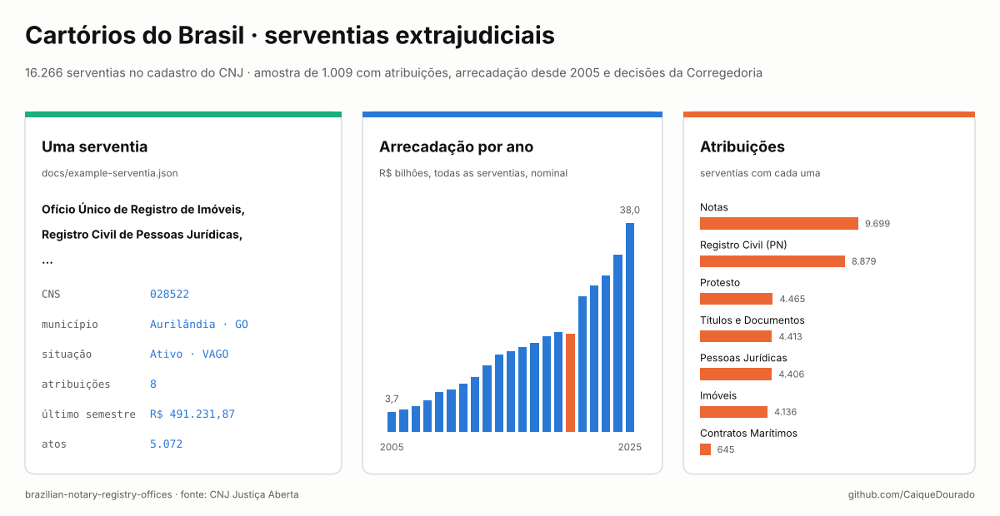
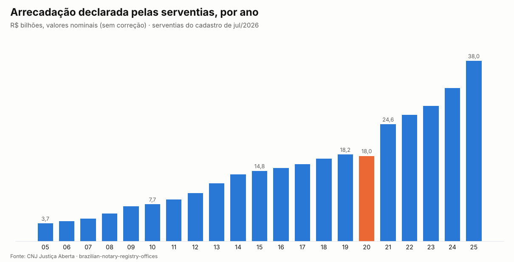
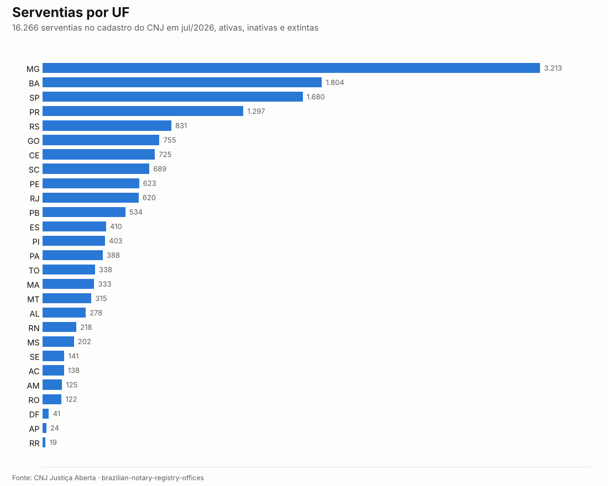
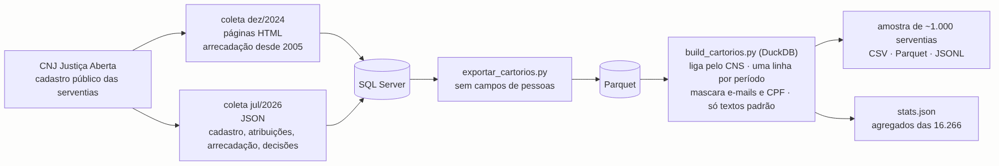

# Cartórios do Brasil · Brazilian Notary and Registry Offices

[](https://github.com/CaiqueDourado/brazilian-notary-registry-offices/actions/workflows/validate.yml)
[](LICENSE-DATA.md)
[](LICENSE)
[](https://www.kaggle.com/datasets/caiquedourado/brazilian-notary-registry-offices)

[Read in English](README.md)



O Brasil tem **16.266 serventias extrajudiciais** (cartórios) no cadastro do Conselho Nacional de Justiça (CNJ):
onde se lavram escrituras, se registram nascimentos e casamentos, se registram imóveis e se protestam títulos. Este
dataset é uma **amostra de 1.009 delas**, estratificada por UF, com tudo o que o CNJ publica sobre cada uma:

- o **cadastro**: denominação, CNS, situação, endereço, telefone, e-mail institucional, horário, colaboradores;
- as **atribuições** de cada uma (notas, registro civil, imóveis…);
- os **atos e a arrecadação** declarados, por semestre, **de 2005 a 2026**;
- as **decisões da Corregedoria do CNJ** sobre ela (provida por concurso, declarada vaga…).

O `stats.json` traz os agregados de **todas as 16.266** (por UF, situação, atribuição, arrecadação por ano).

## O que tem dentro

| Arquivo | Linhas | O quê |
|---|---:|---|
| `serventias.csv` / `.parquet` | 1.009 | uma serventia por linha, cadastro de jul/2026 |
| `atribuicoes.csv` | 2.311 | serventia × atribuição |
| `arrecadacao.csv` | 38.272 | serventia × período: atos e arrecadação, 2005–2026 |
| `decisoes.csv` | 4.402 | serventia × decisão da Corregedoria |
| `serventias.jsonl` | 1.009 | a mesma amostra, um JSON aninhado por serventia |
| `stats.json` | | contagens do build e agregados das 16.266 serventias |

Todos os arquivos estão em [`data/`](data) e no [Kaggle](https://www.kaggle.com/datasets/caiquedourado/brazilian-notary-registry-offices).
Eles se ligam pelo `cns`, o Código Nacional da Serventia.

## Uma serventia em JSON


Cada linha do `serventias.jsonl` é uma serventia com atribuições, arrecadação e decisões aninhadas, como
[docs/example-serventia.json](docs/example-serventia.json) (a imagem corta as listas longas).

## Dicionário de dados

**serventias**

| Coluna | Exemplo | O quê |
|---|---|---|
| `cns` | 028522 | Código Nacional de Serventia, 6 dígitos |
| `denominacao` | Ofício Único de Registro de Imóveis… | denominação oficial |
| `status` | Ativo | Ativo, Inativo ou Extinto |
| `tipo` | PRIVATIZADO | PRIVATIZADO (delegada), OFICIALIZADO (do Estado), PUBLICO |
| `situacao` | VAGO | situação jurídica: PROVIDO (por concurso), VAGO, INATIVA… |
| `tipo_responsavel` | Interino | Titular, Interino, Interventor… A pessoa **não** está no dataset |
| `data_criacao` | 1949-03-11 | data de criação |
| `data_ultima_decisao` | 2025-10-13 | data da última decisão do CNJ |
| `uf`, `municipio` | GO, Aurilândia | UF e município |
| `codigo_ibge` | 5202601 | código IBGE: liga com [municipios-e-estados-do-brasil](https://github.com/CaiqueDourado/municipios-e-estados-do-brasil) |
| `bairro`, `cep`, `endereco`, `numero` | Centro, 76120000… | endereço; `cep` só dígitos |
| `telefone` | 64936841416 | telefone da serventia, só dígitos, com DDD |
| `email` | atendimento@registro….com.br | e-mail da serventia; `***@dominio` quando mascarado |
| `email_mascarado` | false | true quando a caixa foi mascarada (veja *Privacidade*) |
| `website` | | site, valores inválidos removidos |
| `horario_funcionamento` | segunda-feira: 08:00 - 17:00; … | horário |
| `informatizada`, `acesso_internet` | true | informatizada, tem internet |
| `conciliacao_mediacao`, `sistema_interligado` | false | faz mediação; participa do sistema interligado do registro civil |
| `funcionarios_clt`, `funcionarios_estatutarios` | 2, 0 | funcionários por regime |
| `colaboradores_estagiarios`, `_terceirizados`, `_total` | 2, 0, 4 | estagiários, terceirizados, total |

**atribuicoes**: `cns`, `atribuicao` (Notas, Registro Civil das Pessoas Naturais, Protesto de Títulos, Registro de
Títulos e Documentos, Registro Civil das Pessoas Jurídicas, Registro de Imóveis, Registro de Contratos Marítimos,
Registro de Distribuição, Registro de Interdições e Tutelas).

**arrecadacao**

| Coluna | Exemplo | O quê |
|---|---|---|
| `cns` | 028522 | serventia |
| `inicio`, `fim` | 2026-01-01, 2026-06-30 | o período: um semestre (os primeiros anos podem ser o ano inteiro) |
| `situacao` | informado | `informado`, `pendente` (ainda não declarado), `nao_informado` |
| `atos` | 5072 | atos no período |
| `valor` | 491231.87 | arrecadação no período, R$, valor nominal |
| `fonte` | 2026 | de qual coleta vem: `2026` (jul/2026) ou `2024` (dez/2024), para os períodos que 2026 não tem |

**decisoes**

| Coluna | Exemplo | O quê |
|---|---|---|
| `cns` | 028522 | serventia |
| `status` | PROVIDO | situação definida pela decisão |
| `numero_processo`, `evento_processo` | 0006769-05.2010.2.00.0000 | processo administrativo, quando há |
| `codigo_decisao` | 3 | código do tipo de decisão |
| `data_decisao`, `data_inclusao` | 2025-06-13 | data da decisão; quando entrou no sistema do CNJ |
| `texto` | Provido por meio de Concurso… | texto da decisão, **só textos padrão** (veja *Privacidade*) |
| `texto_omitido` | false | true quando o texto existe mas ficou de fora |

## O site de onde isto vem

O crawler deste dataset foi escrito em 2024 para o **Portal de Cartórios no Brasil** (`****.com.br`, site de um
cliente, endereço omitido), um guia com uma página por serventia (endereço, telefone, atribuições, histórico de arrecadação) para quem procura um cartório ou uma certidão.
As páginas eram geradas a partir destas tabelas e publicadas no WordPress. Em 2026 o crawler foi reescrito para as
novas páginas em JSON do CNJ, que trouxeram as decisões da Corregedoria.


Tráfego orgânico do portal estimado pelo Semrush, de nov/2024 a out/2026: cerca de 116 mil visitas por mês no fim
do período.

## O que os dados mostram



- **A arrecadação cresceu dez vezes em valores nominais**: R$ 3,7 bilhões em 2005, R$ 18,2 bilhões em 2019, R$ 38,0
  bilhões em 2025 (serventias do cadastro de 2026, sem correção pela inflação). 2020 caiu um pouco (R$ 18,0 bilhões) e
  2021 saltou 37%, para R$ 24,6 bilhões. O salto não é a troca de coleta: nos períodos que as duas coletas têm
  (2020–2024), os totais diferem menos de 0,4%.
- **A arrecadação é concentrada.** Na amostra, a serventia mediana declarou R$ 440 mil em 2025; as 50 maiores (5%)
  ficaram com 54% do total. Serventias com registro de imóveis arrecadam R$ 152 por ato; as demais, R$ 50.
- **Minas Gerais tem mais serventias** (3.213), depois Bahia (1.804) e São Paulo (1.680); Roraima tem 19. Muitos
  municípios pequenos e distritos têm o seu próprio registro civil.
- **Notas (9.699 serventias) e registro civil (8.879)** são as atribuições mais comuns; 4.136 fazem registro de
  imóveis. 12.203 estão ativas, 3.881 inativas e 182 extintas; 79% são privatizadas (delegadas).
- **Quase metade das decisões diz *vago*.** VAGO é a situação de 35.306 das 73.774 decisões: desde a Resolução 80 (2009)
  o CNJ revisa as serventias providas sem concurso depois da Constituição de 1988.



## Como usar

```python
import duckdb

d = "data"     # no Kaggle: /kaggle/input/brazilian-notary-registry-offices
duckdb.sql(f"""
  SELECT s.municipio, s.denominacao, a.valor
  FROM '{d}/serventias.parquet' s JOIN '{d}/arrecadacao.csv' a USING (cns)
  WHERE s.uf = 'SP' AND a.inicio = '2025-07-01' AND a.situacao = 'informado'
  ORDER BY a.valor DESC LIMIT 10""").show()
```

O [notebook](notebooks/estudo.ipynb) tem mais: serventias por UF, combinação de atribuições, arrecadação por ato, as
decisões e a ligação com os municípios.

## Como foi feito



- **Fonte.** O cadastro público de serventias do CNJ, o *Justiça Aberta* (justicaaberta.cnj.jus.br): uma página por
  serventia com cadastro, atribuições, arrecadação e histórico de decisões.
- **Duas coletas.** Dez/2024 (páginas HTML; a série de arrecadação começa em 2005) e jul/2026 (as novas páginas em
  JSON: cadastro, atribuições, semestres desde 2012 e as decisões). O cadastro de 2026 é a base; a série de 2024
  completa os períodos que 2026 não tem, ligada pelo CNS (normalizado para 6 dígitos: 2024 escrevia `00.361-6`, 2026
  `000361`).
- **Exportação** ([scripts/exportar_cartorios.py](scripts/exportar_cartorios.py)): SQL Server → Parquet, sem os
  campos de pessoas (nome e CPF do responsável e dos substitutos) e sem as páginas brutas.
- **Build** ([scripts/build_cartorios.py](scripts/build_cartorios.py), DuckDB): datas convertidas; `Pendente` e
  `Não Informado` viraram `situacao`; períodos lidos de *De dd/mm/aaaa até dd/mm/aaaa*, corrigindo entidades HTML e
  codificação quebrada (`até`); **1.445.124 linhas de arrecadação duplicadas removidas** (a coleta de 2024 tem
  algumas serventias com vários ids); período de 2024 descartado quando se sobrepõe a um de 2026; mascaramento
  (abaixo); amostra sorteada por UF.
- **Conferências** ([scripts/validate.py](scripts/validate.py), no CI): chaves, ligações, períodos sem sobreposição,
  nenhum CPF, nenhum e-mail pessoal, nenhum HTML.

## Privacidade

O CNJ publica tudo isto, mas parte é sobre pessoas, então o dataset deixa de fora:

- **Nenhum campo de pessoa.** Nome e CPF do responsável e dos substitutos nunca foram exportados.
  `tipo_responsavel` diz só *Titular*, *Interino*…
- **E-mails.** Das 15.360 serventias com e-mail, 11.887 usam provedor pessoal (Gmail, Hotmail, Yahoo, Bol…): a
  caixa é mascarada, `***@gmail.com`. Caixas em domínios institucionais que são nome de pessoa (`maria.souza@tj…`) são
  mascaradas do mesmo jeito (710). Caixas de função (`contato@`, `cartorio@`, `registrocivil@`…) ficam: 2.763. O
  telefone é o da serventia e fica.
- **Textos das decisões.** As decisões longas (pareceres) citam os responsáveis pelo nome. O `texto` só é mantido
  quando o mesmo texto aparece em pelo menos 25 serventias e tem até 600 caracteres, ou seja, um texto padrão
  (*Status alterado pela corregedoria estadual*, *Provido por meio de Concurso…*). 83% das 73.774 decisões mantêm o texto; as demais têm `texto_omitido = true`. CPFs e e-mails pessoais
  dentro dos textos mantidos também são mascarados.
- **Só uma amostra** é publicada, por escolha.

Se encontrar dado pessoal aqui, abra uma issue: ele sai na próxima versão.

## Limites

- **Uma amostra.** 1.009 serventias, pelo menos 5 por UF, proporcional ao total de cada UF. Para totais
  nacionais, use o `stats.json`.
- **A arrecadação é a declarada pelas serventias**, em R$ nominais, sem auditoria e sem correção pela inflação.
  Períodos `pendente` ainda não têm valor, então os últimos semestres estão incompletos.
- **Arrecadação de serventias fechadas.** Só entram as serventias do cadastro de jul/2026; uma extinta antes disso,
  com sua arrecadação passada, não.
- **Duas fontes numa série.** Até 2020-S1 a maior parte dos valores vem da coleta de dez/2024; depois, da de jul/2026.
  Nos períodos que as duas têm (2020–2024), os totais diferem menos de 0,4%.
- **Cadastro como digitado pelas serventias**: erros em endereços (*Rus 7 Quedas*), municípios escritos diferente do
  IBGE (*Sant'Ana do Livramento*); o `codigo_ibge` é a chave segura.

## Precisa dos dados completos ou de um crawler assim?

Este repositório publica uma amostra de propósito. O mesmo crawler coleta as 16.266 serventias, com a série de
arrecadação e o histórico de decisões, e pode atualizá-las periodicamente. Se você precisa dos dados completos, de uma
atualização, ou de um crawler e pipeline de dados para outra fonte pública, fale comigo no
[LinkedIn](https://www.linkedin.com/in/caiquedourado/) ou por [github.com/CaiqueDourado](https://github.com/CaiqueDourado).

## Relacionados

- [municipios-e-estados-do-brasil](https://github.com/CaiqueDourado/municipios-e-estados-do-brasil): os 5.570 municípios, para ligar pelo `codigo_ibge` (população, região, coordenadas) ([Kaggle](https://www.kaggle.com/datasets/caiquedourado/municipios-e-estados-do-brasil)).
- [PtBr.Text](https://github.com/CaiqueDourado/PtBr.Text): utilitários de CEP, DDD e CPF/CNPJ para .NET.
- [scrapladder](https://github.com/CaiqueDourado/scrapladder): a biblioteca de coleta de páginas do autor (Python).

## Licença

Dados: [CC BY 4.0](LICENSE-DATA.md), com crédito ao CNJ como fonte. Código: [MIT](LICENSE).

## Autor

**Caique Dourado**: 20 anos construindo crawlers, pipelines de dados e SEO programático em .NET e SQL Server. Mais em [github.com/CaiqueDourado](https://github.com/CaiqueDourado).
